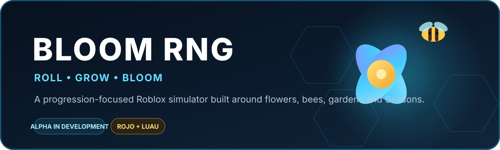
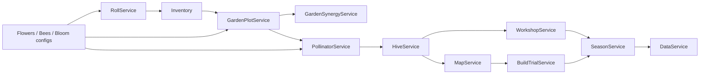

<p align="center">
  
</p>

<p align="center">
  <a href=".github/workflows/gameplay-checks.yml"></a>
  
  
  
  
</p>

<p align="center">
  <strong>Roll rare blooms. Build a garden. Collect bees. Grow through Seasons.</strong>
</p>

<p align="center">
  <a href="README_RU.md">Русская документация</a>
  ·
  <a href="docs/FINAL_QA_REPORT.md">QA status</a>
  ·
  <a href="docs/DEFINITION_OF_DONE.md">Definition of Done</a>
  ·
  <a href="docs/BLOOM_RNG_STORE_PAGE_PACKAGE.md">Store package</a>
</p>

---

## 🌸 What is Bloom RNG?

**Bloom RNG** is a progression-focused Roblox simulator built around rolling, gardening, bees, exploration and layered upgrades.

The core loop is simple:

**Roll → collect a Flower Seed or Bee → plant and build synergies → pollinate → upgrade the Hive → expand through Workshop, locations and Seasons.**

The project is currently an **alpha candidate under active runtime QA**. The source-side gameplay contracts are heavily checked, but real Roblox Studio persistence, multiplayer, soak and low-end acceptance are still open release gates.

## ✨ Current v1 content

| Content | Shipping set |
| --- | ---: |
| 🌷 Flowers | **12** |
| 🐝 Bees | **13** |
| 🗺️ Progression locations | **3** |
| 🏆 Trials | **8** |
| ⬡ Workshop branches | **7 × 6 nodes** |
| ⚡ World activity types | **12** |
| 🍃 Season cards | **5** |
| 💎 Rarity tiers | **7** |

### Progression locations

| Location | Requirement | Signature activity |
| --- | --- | --- |
| ☀️ **Sunny Orchard** | Hive 2 | Solar Bloom |
| 💎 **Crystal Greenhouse** | Hive 4 + Sunny Orchard | Crystal Resonance |
| 🌙 **Twilight Grove** | Hive 6 + Crystal Greenhouse | Firefly Route |

## 🐝 Gameplay pillars

| System | What it does |
| --- | --- |
| 🎲 **Roll / Bloom / Discovery** | Server-authoritative RNG with pity, Bloom charge and rarity presentation |
| 🌱 **Garden** | Physical planting slots, flower levels, mutations and layout synergies |
| 🐝 **Bees** | Equipment, traits, mastery, active abilities and pollination runtime |
| 🍯 **Hive** | Main world progression gate and bee-capacity progression |
| ⬡ **Workshop** | Full-screen hex progression tree across seven branches |
| 🏆 **Trials & activities** | Movement, delivery, ability, mutation and synergy challenges |
| 🍂 **Seasons & Legacy** | Long-form reset loop with permanent progression |

## 🧱 Architecture



The server is authoritative for rewards, costs, ownership, unlocks, roll results, inventory, Garden, Hive and Workshop progression. Client controllers handle presentation, input and local visual replication.

## 🛠️ Tech stack

| Area | Technology |
| --- | --- |
| Game | Roblox Studio |
| Language | Luau |
| Project sync | Rojo 7.7 |
| UI source | Authored `StarterGui/BloomUI` + Bloom UI Studio |
| Persistence | DataStore-backed profile lifecycle with schema migration |
| CI | GitHub Actions + deterministic gameplay/persistence checks |
| Runtime QA | `RuntimeAcceptanceProbe` + `PersistenceProbe` |

## 🚀 Quick start

```text
1. Clone the repository.
2. Run "Build Bloom.bat".
3. Open BloomRNG.rbxl in Roblox Studio.
4. For live sync, run "Sync Rojo.bat" and connect the Rojo plugin.
5. Press Play and inspect Output.
```

For DataStore testing, use a published test place with Studio API access enabled. Production and Studio DataStore names are intentionally separated.

Native smoke tests can be started from the **Server Command Bar**:

```luau
require(game.ServerScriptService.Tests.SmokeTests).Run()
```

## 🧪 Alpha readiness

| Gate | Status |
| --- | --- |
| Core progression contracts | ✅ Source / CI verified |
| Roll, Garden, Bees, Hive, Workshop wiring | ✅ Deterministic checks |
| Remote validation / authority | ✅ CI guarded |
| Desktop authored HUD geometry | ✅ 1920×1080 / 1366×768 / 1280×720 |
| Clean Rojo build artifact | ✅ Automated |
| Fresh-profile Studio onboarding | ⏳ Runtime verification |
| Join → leave → rejoin persistence | ⏳ Runtime verification |
| Real DataStore failure/throttling | ⏳ Runtime verification |
| Multiplayer shared-world acceptance | ⏳ Runtime verification |
| Low-end 10-minute baseline | ⏳ Runtime verification |
| 15 / 30 / 60 minute soak | ⏳ Runtime verification |
| Private release-candidate playtest | ⏳ Pending |

See [FINAL_QA_REPORT.md](docs/FINAL_QA_REPORT.md) for the current release blockers and [DEFINITION_OF_DONE.md](docs/DEFINITION_OF_DONE.md) for the full acceptance matrix.

## 🧭 RoFlow

RoFlow is now a **standalone repository/application**: `itsrekito-stack/RoFlow`.

This game repository only owns its project-specific contract:

- `roflow.project.json` — stable project ID, build output, RuntimeProbe/release settings and UI Studio states.
- `roflow/planner-defaults.json` — Bloom RNG's own Planner goals/tasks.
- `.roflow/` — local ignored runtime state such as checked tasks, task history and backups.

Switching to another project in RoFlow does not reuse this project's Planner, UI state, backups or RuntimeProbe configuration.

## 📁 Repository map

```text
Bloom_RNG/
├─ src/
│  ├─ ReplicatedStorage/      shared configs and gameplay contracts
│  ├─ ServerScriptService/   authoritative services, data and tests
│  ├─ StarterGui/            authored editable Roblox UI
│  ├─ StarterPlayer/         client controllers and presentation
│  └─ Workspace/             authored world source
├─ tools/
│  └─ checks/                deterministic/static gameplay QA
├─ roflow/                   this project's RoFlow planner defaults
├─ roflow.project.json       project-scoped RoFlow contract
├─ tests/                    persistence and gameplay harnesses
├─ docs/                     audits, phase reports and release docs
└─ default.project.json      Rojo project
```

## 🎨 Visual direction

Bloom RNG uses a consistent simulator UI language:

**dark navy surfaces · cyan/blue borders · rounded corners · restrained glow · gold progression accents · rarity-driven color**

Gameplay UI is authored as real Roblox GUI objects rather than flattened screenshots, so it remains editable in Studio.

## 🔐 Project principles

> **Server authority first.**  
> Rewards, costs, ownership and progression are never trusted to the client.

> **One source of truth.**  
> Gameplay registries and progression rules stay centralized instead of being duplicated between client/server/config.

> **Alpha before polish.**  
> Release-blocking correctness, persistence and runtime stability take priority over decorative scope.

---

<p align="center">
  <strong>Bloom RNG</strong><br>
  <sub>Built for Roblox with Luau + Rojo.</sub>
</p>
