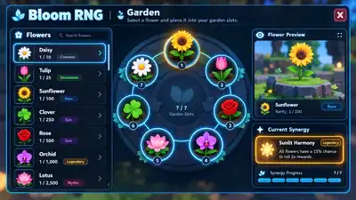

# Bloom RNG — Game Vision Q&A

**Date:** 2026-09-28  
**Status:** Active design source  
**Purpose:** Preserve the agreed product vision from the Q&A session. When implementation details conflict with this document, treat the answers below as the intended direction unless a later design decision explicitly supersedes them.

---

## 1. Core feeling and Roll

### Q1. Какое главное ощущение должен получить новый игрок в первые 10 минут?
**Answer:** Первый Roll должен давать классные ощущения и сразу цеплять игрока. RNG/reveal должен ощущаться азартно и зрелищно.

### Q2. Каким должен быть темп Roll?
**Answer:** В начале игры Roll медленный — примерно **4–5 секунд**. Первые слоты пролетают быстро, а ближе к концу рулетка всё сильнее замедляется. После прокачки Roll должен занимать примерно **2–3 секунды**.

### Q3. Что должно происходить, когда рулетка почти останавливается на очень редком предмете?
**Answer:** Можно и нужно использовать дополнительные эффекты: затемнение, изменение звука, дополнительное замедление, вспышки/частицы и отдельный reveal.

### Q4. Насколько сильно должны различаться редкости визуально?
**Answer:** **Сильно и по-разному.** Верхние rarity должны ощущаться как разные события, а не как один эффект с другим цветом.

### Q5. Каким должен быть визуальный характер верхних rarity?
**Answer:**
- **Legendary** — золотой, яркий, дорогой.
- **Mythic** — фиолетовый, магический.
- **Celestial** — бело-голубой, космический.

### Q6. Что игрок должен хотеть делать сразу после удачного Roll?
**Answer:** **B + C + D**
- посмотреть/экипировать новую Bee;
- использовать новый Flower в Garden;
- посмотреть, что новый предмет открыл или изменил в прогрессии.

### Q7. Насколько сильно игра должна вытаскивать игрока из HUD в мир?
**Answer:** **C.** Часто: Roll → получил что-то → пошёл использовать это физически в мире.

---

## 2. Garden, Flowers and Synergies

### Q8. Какую роль должен играть Garden?
**Answer:** **B + C.**
- Garden должен быть красивой коллекцией цветов.
- Одновременно это важная build-система: выбор цветов, уровни и Synergies имеют значение.

### Q20. Как прокачиваются уровни Flowers?
**Answer:** **A.** Дубликат конкретного Flower автоматически прокачивает **именно этот Flower**.

### Q21. Насколько сильно уровень Flower должен влиять на Synergy?
**Answer:** **C.** У каждого Flower внутри комбинации могут быть свои важные пороги уровня.

### Q22. Как игрок должен узнавать о возможных Flower Synergies?
**Answer:** **B.** В Index появляются только уже найденные комбинации.

**Design intent:** это должно создавать загадку, обсуждения и community discovery. Даже развитый игрок не должен автоматически считать игру полностью пройденной после последней Location: у него всё ещё должно оставаться много неизвестных комбинаций.

### Q23. Как игрок получает подсказку к неизвестной Synergy?
**Answer:** Если у игрока уже стоят **6 Flowers**, то в оставшемся слоте может появиться **“призрачный” Flower-подсказка**.

Условия:
- Ghost Flower должен быть у игрока в Inventory.
- Он должен завершать конкретную ещё не открытую комбинацию.
- Игра не должна прямо раскрывать название/рецепт Synergy до открытия.

### Q24. Что делать, если из текущего набора можно прийти к нескольким комбинациям?
**Answer:** Подсказка должна предлагать не абсолютную “самую сильную в игре” комбинацию, а **оптимальный вариант для текущего уровня прогрессии игрока**.

### Q25. Как определяется активная Synergy, если подходят несколько?
**Answer:** По принципу **покерной комбинации**. Из текущего набора автоматически работает **самая сильная валидная Synergy**.

Пример логики:
- A + B активирует Synergy A+B.
- Если A + B + C образуют более сильную Synergy, работает уже A+B+C, а A+B отдельно не стакается.
- Если более сильная комбинация перестаёт быть валидной, система автоматически возвращается к следующей доступной по силе.
- Игрок может намеренно убрать элемент, чтобы перейти на более слабую комбинацию, если ему нужен именно её эффект.

Не каждый набор цветов обязан давать Synergy.

### Q26. Можно ли ставить несколько Flowers одного вида?
**Answer:** **B. Нет.** Один вид Flower можно поставить только в одном экземпляре. Покер — аналог иерархии комбинаций, а не буквальное повторение одинаковых карт.

### Q27. Сколько Garden Slots и как начинается Garden?
**Answer:** Игрок начинает с **0 Garden Slots**. Максимум — **7**.

Tutorial:
1. Первый шаг — получить первый Garden Slot.
2. Второй шаг — получить первый Flower. Для этого один раз за игру tutorial Roll использует пул **только Flowers**, чтобы прогресс не зависел от плохого RNG.
3. Третий шаг — получить первую Bee. Следующий tutorial Roll использует пул **только Bees**.
4. После этого Roll возвращается к обычному общему RNG-пулу.

### Q28. Как открываются остальные Garden Slots?
**Answer:** **A. Через Hive Levels.**

### Q32. Как быстро должны открыться все 7 Garden Slots?
**Answer:** Все активные Garden Slots должны быть открыты примерно к **30% прохождения игры**. После этого Hive Levels должны давать другие типы наград.

### Q57. Что должно происходить при выборе Flower в Inventory?
**Answer:** **A.** Справа открывается компактная панель:
- Plant / Remove;
- 1/N;
- Level;
- информация о текущей Synergy.

### Q58. Каким должен быть Garden UI?
**Answer / confirmed layout:**
- Слева — вертикальный список Flowers.
- Справа — UI-круг из **7 слотов**.
- Игрок сначала выбирает Flower слева.
- Затем нажимает на слот, куда хочет его поставить.
- Если слот занят, новый Flower заменяет старый.
- Отдельно отображается текущая Synergy.
- При смене Flower в UI он должен сразу меняться и в физическом мире.

**Visual direction:** сгенерированный в Q&A макет Garden UI был подтверждён как **идеальный ориентир**.

**Reference asset:** `docs/game-vision/assets/bloom-rng-garden-ui-reference.webp`

---

## 3. Bees, Traits and Mastery

### Q9. Как игрок должен воспринимать Bees?
**Answer:** **C.** Bees — полноценная gameplay-система с ролями и abilities, а не просто декоративные pets.

### Q10. Как должны работать Bee abilities?
**Final answer:** **Автоматически.**

### Q11. Насколько сильными должны быть способности редких Bees?
**Answer:** **C.** Очень сильные abilities с длинным cooldown, почти как ultimate.

### Q12. Как должен собираться сильный Bee build?
**Answer:** Слабые Bees должны оставаться объективно слабее сильных, но быть важными как **ключи к мощным Trait-комбинациям**.

Пример design intent: у игрока может быть много очень сильных Bees, но для активации лучшей комбинации ему всё равно нужна одна слабая Bee определённого типа.

### Q13. Как Luck влияет на выпадение слабых Bees?
**Answer:** Чем выше Luck, тем чаще выпадают редкие предметы. Поэтому для поиска слабых Bees игроку иногда полезно сознательно снизить effective Luck.

### Q14. Как игрок должен снижать Luck?
**Answer:** В Settings должен быть отдельный **Luck Control**:
- default = **MAX**;
- игрок может вручную вписать нужное число;
- функция меняет только effective Luck для Roll;
- она **не меняет его билд, экипировку или источники Luck**.

### Q16. Откуда Bee получает Mastery?
**Answer:** **B. Из дубликатов.**

### Q17. Mastery общая для вида Bee или индивидуальная?
**Final answer:** **A. Общая для вида Bee.**

Design intent: если игрок половину игры развивал Magma Bees, ему проще продолжать собирать сильный Magma-архетип. Переход на другую meta-team должен происходить постепенно.

### Q18. Что происходит, когда выпадает ещё одна копия уже имеющейся Bee?
**Answer:**
- Первая выпавшая Bee остаётся основной записью.
- Следующие копии **не занимают слот в Inventory**.
- Дубликаты автоматически идут в Mastery этого вида Bee.
- В Index можно хранить скрытую/дополнительную статистику вроде “Obtained X times”.

### Q19. Что должен давать Bee Mastery?
**Answer:** **D.**
- базовые stat upgrades;
- улучшение ability;
- на высоких уровнях — дальнейшая настройка под Traits/комбинации.

### Trait system — core rule
Bees комбинируются в **Traits как в TFT**.

### Q42. Как должны выглядеть Traits на HUD?
**Answer:** Как на TFT-референсе:
- иконка Trait;
- название;
- компактный показатель **n1 / n2**;
- **n1** = сколько Bees этого Trait сейчас equipped;
- **n2** = сколько нужно до следующего tier/уровня Trait ability.

При hover открывается tooltip с подробностями.

### Q43. Как должны работать Trait tiers?
**Answer:** **C.**
- Простые Traits могут усиливать один и тот же эффект числами.
- Более редкие/сложные Traits на высоких tier могут менять саму механику.

### Q44. Что должно быть главным источником силы Bee-команды?
**Answer:** **D.**
- rarity = базовая сила;
- Mastery = долгосрочный рост;
- Traits = основной build/synergy multiplier.

### Q51. Что происходит с Bee Traits при смене Biome?
**Answer:** **B.** Некоторые Traits получают biome-specific bonus/penalty.

### Q52. Как игрок узнаёт, какие Traits хороши в текущем Biome?
**Answer:** **B.** Эта информация показывается в tooltip при hover, а не постоянно в HUD.

### Q53. Как должны выглядеть Trait tiers?
**Answer:** Как на TFT-референсе. Компактный HUD, подробности — в tooltip.

### Q54. Что происходит, когда активируется новый Trait tier?
**Answer:** **B.**
- небольшой popup;
- краткая подсветка Trait примерно на 1–2 секунды;
- без большого перекрытия экрана.

### Q55. Как работает экипировка Bee?
**Answer:** **A.** Игрок вручную использует Equip / Unequip.

### Q56. Что происходит при выборе Bee в Inventory?
**Answer:** **D.** Справа открывается компактная панель:
- Equip / Unequip;
- 1/N;
- Mastery;
- Traits;
- ability;
- preview того, как изменятся активные Traits после экипировки.

---

## 4. Hive progression

### Q29. Как должен прокачиваться Hive?
**Answer:** **C. Honey + Hive Quests.**

### Q30. Какими должны быть Hive Quests?
**Answer:** **B.** Они должны проверять разные системы игры, а не быть только простыми счётчиками.

Примеры направления:
- открыть Synergy;
- поднять Bee Mastery;
- выполнить Activity;
- получить нужную rarity;
- использовать другие ключевые механики.

### Q31. Что происходит при повышении Hive Level?
**Answer:** **B**, с уточнением:
- Hive Level даёт постоянный бонус;
- награда для всех игроков **одинаковая и статическая**;
- баланс награды подбирается под среднестатистический прогресс на этом уровне;
- Garden Slots открываются только на символических milestone-уровнях, а не каждый уровень.

### Q33. Что Hive Levels дают после открытия всех 7 Garden Slots?
**Answer:** Пока достаточно milestone-бонусов — например, **каждые 10 уровней бонус к Luck или похожий stat reward**. Позже часть milestones можно заменить более интересными наградами, включая Location/Biome progression.

### Q45. Как игрок получает новые Bee Slots?
**Final answer:** **A. Через Hive Levels.**

---

## 5. Workshop

### Q46. Каким должен быть Workshop?
**Answer:** **C.**
- обычные nodes дают stats;
- крупные nodes открывают новые возможности / QoL / важные механики.

### Q47. Как выглядит Workshop progression?
**Answer:** **D.**
- большая hex-grid;
- несколько направлений/веток;
- Workshop Points ограничены;
- игрок не должен быстро забрать всё сразу.

### Q48. Откуда игрок получает Workshop Points?
**Answer:** **B. Hive Levels + ключевые milestone quests.**

### Q49. Когда можно сбрасывать Workshop build?
**Answer:** **При смене Biome.**

### Q50. Что происходит с Workshop при смене Biome?
**Answer:**
- появляются новые Workshop branches;
- игроку предлагают выбор:
  - **KEEP BUILD**
  - **RESET & REFUND**

---

## 6. Biomes / Locations

> **Current alpha note:** Biome mechanic пока не является приоритетом для реализации. Ответы ниже фиксируют future direction.

### Q34. Как новый Biome должен влиять на игру?
**Answer:** **C.** Каждый Biome немного меняет meta: определённые Bee Traits и Flower Synergies там эффективнее.

### Q35. Как работает переход между Biomes сейчас?
**Answer:** **A.** Новый Biome пока просто заменяет старый. Причины возвращаться назад можно добавить позже.

### Q36. Что нужно для перехода в следующий Biome?
**Answer:** **B. Hive Level + ключевые Hive Quests.**

---

## 7. Inventory, HUD and UI

### Q37. Каким должен быть Inventory?
**Answer:** **C.** Компактный и быстрый, в духе Pets Go. Главный показатель ценности предмета — **редкость в формате 1/N**.

### Q38. Что главное на карточке Bee/Flower?
**Answer:** **A.**
- большая/понятная иконка;
- название;
- крупный **1/N**.

### Q39. Как показывать прокачанность предмета?
**Answer:** **A.** Маленький Level/Mastery badge в углу карточки.

### Q40. Как должен выглядеть очень редкий Roll reveal?
**Current answer:** **C.**
- HUD почти исчезает;
- reveal становится главным событием экрана;
- камера/фон временно подчиняются reveal;
- затем обычный HUD возвращается.

**Ideal future direction:** полноценная **walk-out animation** в духе Pets Go, где очень редкие drops физически появляются как отдельное событие, например падают с неба.

### Q41. Каким должен быть основной HUD?
**Answer:** **D**, с конкретной структурой.

На обычном экране:
- Roll button;
- Inventory button;
- currency counters;
- Traits слева;
- Hive progress bar сверху.

Когда открыт Inventory:
- Roll должен быть **Visible = false**;
- остальные основные нижние кнопки доступны внутри/рядом с Inventory;
- экран должен оставаться максимально чистым.

---

## 8. Final design principles captured by this Q&A

### Roll
- Roll — главный эмоциональный вход в игру.
- Roll animation ускоряется через progression.
- Upper rarities должны иметь разные reveal languages.
- Very rare drops в будущем получают walk-out moments.

### Garden
- Garden = collection showcase + build system.
- Максимум 7 unique Flowers.
- Hidden Synergies создают discovery/meta/community discussion.
- Одновременно работает сильнейшая валидная Synergy.
- Ghost hint помогает открыть подходящие комбинации, не раскрывая весь рецепт заранее.
- Все 7 slots открываются примерно к 30% прохождения.

### Bees
- Bee strength складывается из rarity + Mastery + Traits.
- Weak Bees остаются полезны как combination enablers.
- Duplicates не захламляют Inventory и идут в species Mastery.
- Abilities работают автоматически.
- Traits визуально и логически вдохновлены TFT.

### Hive
- Hive — центральная progression axis.
- Уровень требует Honey + Hive Quests.
- Hive выдаёт Garden/Bee slots на milestone levels.
- Награды статические и одинаковые для всех игроков.

### Workshop
- Hex-tree с ограниченными points.
- Stats на обычных nodes, новые возможности на крупных.
- Biome change даёт возможность respec и открывает новые branches.

### UI
- HUD минимальный.
- Inventory компактный.
- Главный показатель rarity — **1/N**.
- Garden editor: flower list слева + 7-slot circle справа.
